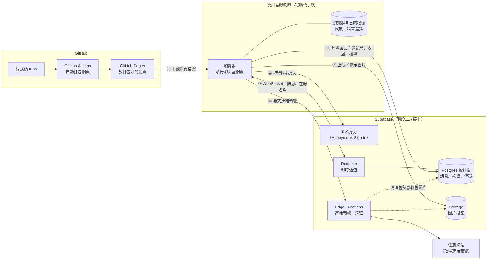
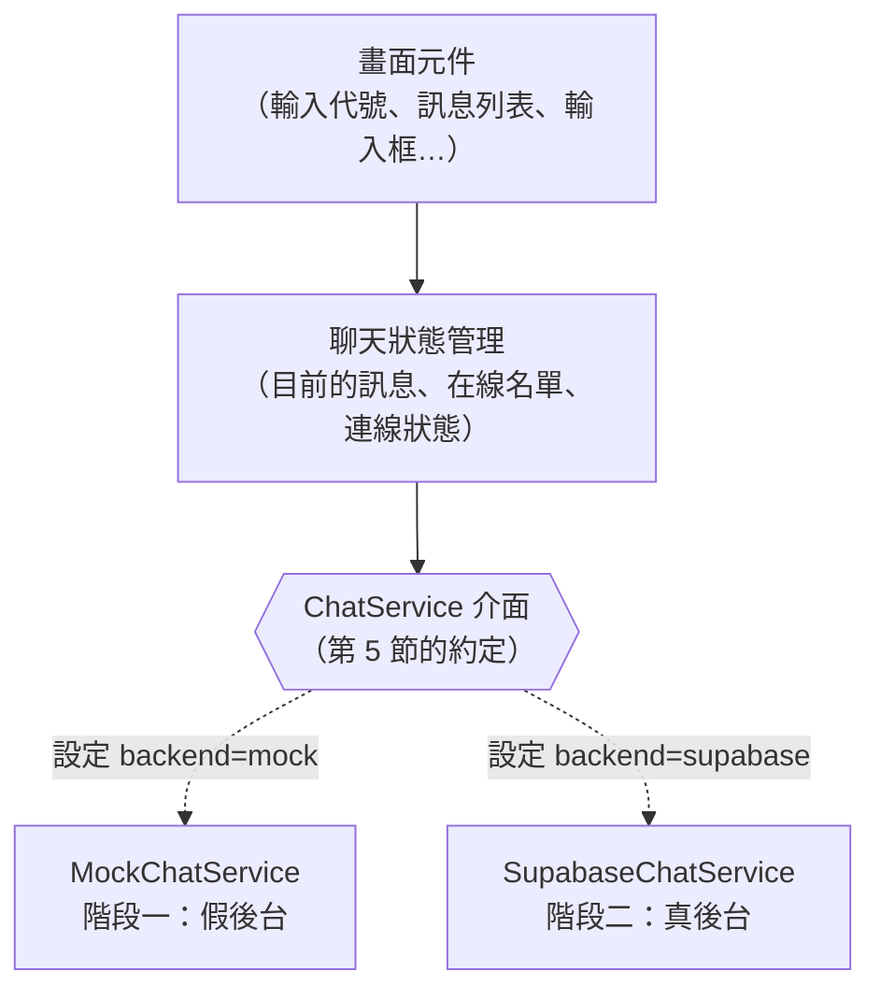
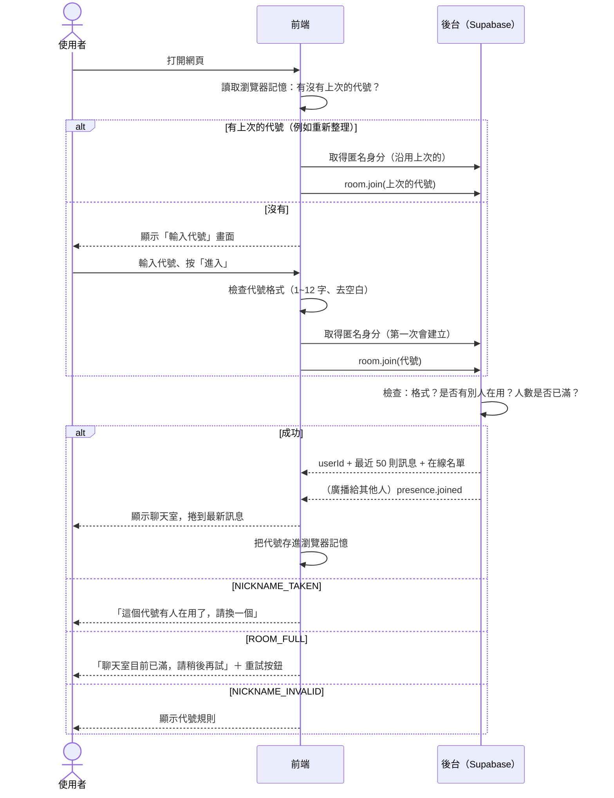
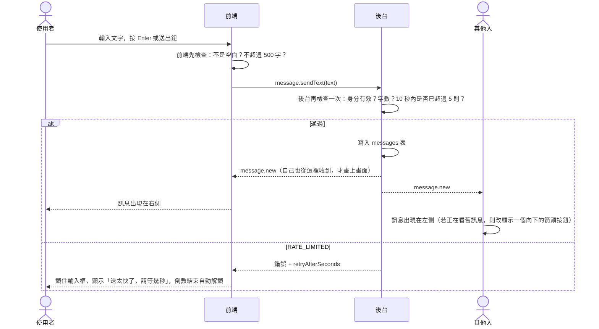
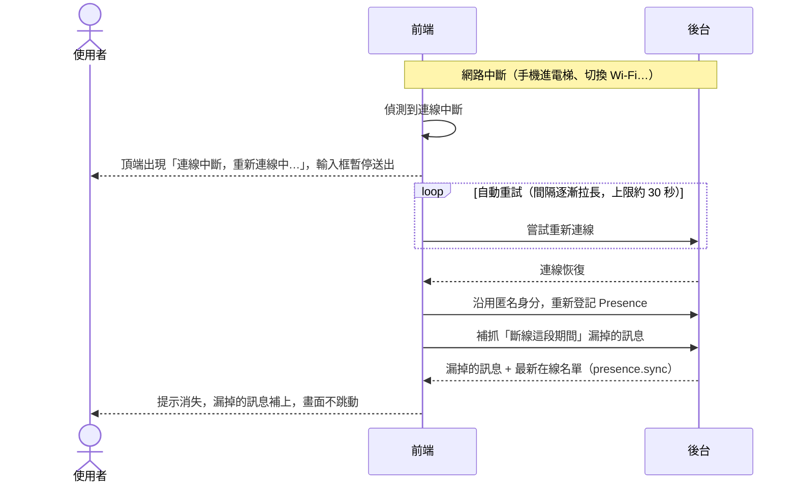

# 匿名聊天室：架構文件

> 這份文件寫給「不寫程式、但要決定產品長什麼樣子」的人看。
> 專有名詞第一次出現時，會用一句話解釋。
> 需求來源：`docs/requirements.md`，加上我們逐題確認過的細節（文中標示為「Q 編號」）。

---

## 目錄

1. [專案說明與目標](#1-專案說明與目標)
2. [整體架構圖](#2-整體架構圖)
3. [技術選擇](#3-技術選擇)
4. [兩個階段](#4-兩個階段)
5. [通訊約定](#5-通訊約定)
6. [資料流](#6-資料流)
7. [畫面清單](#7-畫面清單)
8. [金鑰](#8-金鑰)
9. [安全與限制](#9-安全與限制)
10. [這一版刻意不做的事](#10-這一版刻意不做的事)
11. [Repo 資料夾結構](#11-repo-資料夾結構)
12. [部署到 GitHub Pages](#12-部署到-github-pages)
13. [驗證清單](#13-驗證清單)
14. [附錄：我替你補上的預設值](#14-附錄我替你補上的預設值)

---

## 1. 專案說明與目標

### 這是什麼

一個**不用註冊、不用登入**的匿名聊天室。所有人在同一個聊天室裡，用電腦或手機打開網址、取一個代號就能聊天。

### 使用者會做什麼

1. 打開網頁，輸入代號（1 到 12 個字）。
2. 進入聊天室，看到最近 50 則訊息，也看得到誰在線上。
3. 傳文字、表情符號、圖片；網址可以直接點，還會出現連結預覽。
4. 看不懂的訊息，可以按「翻譯」，在訊息下方看中英文譯文。
5. 傳錯了可以收回；看到不當內容可以檢舉。
6. 按「離開」，或直接關掉頁面離開。

### 目標

| 目標 | 說明 |
|---|---|
| 零門檻 | 不需要任何帳號，知道網址就能用 |
| 手機電腦都好用 | 同一份網頁，自動適應螢幕大小 |
| 先看得到畫面，再接即時功能 | 先把前端做好放上網，最後才接 Supabase（見第 4 節） |
| 免費 | 全部用免費方案，不需要任何付費服務（翻譯用瀏覽器內建的功能，見第 3.3 節） |
| 前端不用重寫 | 接上 Supabase 時，畫面程式幾乎不用動（見第 4 節） |

### 名詞：先講三個最常出現的

- **GitHub Pages**：GitHub 提供的免費網頁空間，只能放「現成的網頁檔案」，不能跑自己的伺服器程式。
- **Supabase**：一個「雲端後台」服務，幫我們存資料、存圖片、即時傳訊息。免費方案夠這個專案用。
- **WebSocket**：瀏覽器和伺服器之間一條「一直開著的電話線」。有人說話，伺服器可以馬上推給你，不用你一直問「有新訊息嗎？」。

---

## 2. 整體架構圖

### 一句話版本

使用者的**瀏覽器**從 **GitHub Pages** 下載網頁；網頁打開後，再直接連到 **Supabase** 聊天。GitHub Pages 只負責「把網頁交給你」，聊天內容完全不經過它。

### 架構圖



### 名詞解釋（第一次出現）

| 名詞 | 一句話解釋 |
|---|---|
| **瀏覽器端／前端** | 在使用者裝置上執行的部分，也就是你看到的畫面和按鈕 |
| **後端** | 在雲端執行、使用者看不到的部分。這個專案的後端就是 Supabase |
| **GitHub Actions** | GitHub 內建的「自動化機器人」：你一上傳程式碼，它就自動把網頁打包好並放上 GitHub Pages |
| **匿名身分（Anonymous Sign-in）** | Supabase 的功能：使用者什麼都不用填，系統自動發給瀏覽器一個隨機的「身分證號」。使用者看不到，也不用登入，但系統可以靠它知道「這則訊息是不是你寫的」 |
| **Realtime（即時通道）** | Supabase 的即時功能，底層就是 WebSocket |
| **Postgres 資料庫** | Supabase 用來存資料的資料庫。資料以「表格」（table）形式保存，像 Excel 的工作表 |
| **Storage** | Supabase 用來存檔案（這裡是圖片）的空間 |
| **Edge Function（邊緣函式）** | 一小段放在 Supabase 雲端、被呼叫時才會執行的程式。有些事不能在瀏覽器裡做（需要藏金鑰、要去別的網站抓東西），就交給它 |
| **Translator API** | 瀏覽器（電腦版 Chrome 138 以上、Edge 148 以上）內建的翻譯功能，翻譯在使用者自己的電腦上做，不經過任何後台，也不用錢 |

### 為什麼連結預覽要經過 Edge Function

連結預覽需要「替使用者去讀別人的網站」。瀏覽器基於安全規定，大多數網站不允許網頁這樣讀，所以一定要有「中間人」，也就是 Edge Function。

清理舊訊息、刪除舊圖片也要有人在後台定時做（直接用資料庫指令刪圖片，只會刪掉紀錄、檔案還在），這也交給 Edge Function。

翻譯**不需要**後台：用瀏覽器內建的 Translator API，見第 3.3 節。

---

## 3. 技術選擇

每一項都寫「選了什麼」和「為什麼」。

### 3.1 前端

| 項目 | 選了什麼 | 為什麼 |
|---|---|---|
| 程式語言 | **TypeScript** | 它是 JavaScript 加上「資料格式檢查」。第 5 節定義的訊息格式，會被寫成程式能檢查的形式，格式對不上時，打包階段就會報錯，不會等到使用者遇到才發現 |
| 框架 | **React** | 「框架」是一套組織畫面的方法。聊天室的畫面會一直變（新訊息、人進出、斷線），React 擅長「資料變了，畫面自動跟著變」。也是 `/frontend-design` 最常產出的形式 |
| 打包工具 | **Vite** | 把我們寫的原始碼打包成瀏覽器看得懂的網頁檔案，速度快，設定少，輸出的是純靜態檔案，正好符合 GitHub Pages 的限制 |
| 樣式 | **純 CSS，並把顏色、字體、間距集中成「設計變數」** | 你說顏色之後再選。把所有顏色放在**同一個檔案**（`theme.css`），之後換配色只改這一個檔案 |
| 多語言 | **自己寫兩份文字表**（繁體中文、英文） | 只有兩種語言，不需要引入大型套件 |
| 表情符號選單 | **`emoji-picker-element`**（開源的小套件） | 不用自己做幾千個表情。若之後不滿意可以換掉，只會影響輸入框那一個元件 |
| 測試工具 | **Vitest**（測邏輯）；**Playwright**（模擬真人點擊整個流程，可選） | 讓「驗證清單」中的部分項目可以自動跑 |

**沒有選的方案：**

- 純 HTML + JavaScript：最簡單，但這個專案有「重新連線、在線名單、雙語、翻譯展開收起」等會互相影響的狀態，手寫容易亂。
- Next.js（另一個常見的 React 框架）：主要價值在「伺服器端功能」，GitHub Pages 用不到，只會增加設定。

### 3.2 後端：Supabase 的哪些功能

| 需求 | 用 Supabase 的什麼功能 | 為什麼 |
|---|---|---|
| 誰在線上、有人進來／離開 | **Realtime Presence**（在線狀態）：每個人連上就「登記」自己，離開或斷線時自動註銷，所有人即時收到更新 | 這正是它的設計用途，不用自己判斷誰斷線了 |
| 新訊息即時出現 | **Realtime Postgres Changes**（資料庫變動通知）：訊息一寫進資料庫，所有連線中的人立刻收到 | 「存起來」和「推給大家」一次完成，不會出現「收到但沒存到」或「存了但沒收到」 |
| 保存最近 50 則歷史 | **Postgres 資料庫的 `messages` 表** | 新進來的人需要讀歷史，一定要存起來 |
| 圖片 | **Storage**（一個叫 `chat-images` 的公開資料夾） | 圖片不能塞進資料庫，要放在檔案空間，訊息裡只記「檔案位置」 |
| 不登入也能辨認「誰是誰」 | **Anonymous Sign-in（匿名身分）** | 收回訊息、檢舉（每人一次）、重新整理後認得自己，都需要一個穩定的身分。匿名身分讓這件事不需要使用者做任何事 |
| 控制「誰能做什麼」 | **Row Level Security（RLS，列級安全）+ 資料庫函式** | RLS 是資料庫層級的規則：「這張表，誰能讀、誰能寫」。我們把規則設成「瀏覽器不能直接寫入訊息表，只能透過幾個受控的函式」，檢查（頻率限制、字數、代號是否重複）全部在這些函式裡做，不信任瀏覽器 |
| 連結預覽、清理 | **Edge Functions**（`link-preview`、`cleanup`） | 原因見第 2 節。因為是在 Supabase 後台的網頁編輯器貼上，每個函式必須是**單一檔案**（編輯器不支援多檔案共用） |
| 翻譯 | **不用後台**：瀏覽器內建的 Translator API | 見第 3.3 節 |
| 定時清理舊訊息／舊圖片 | **pg_cron**（資料庫內建的排程）呼叫 Edge Function | 每隔一段時間自動執行一次，不需要人手動 |

**沒有選的：** Realtime Broadcast（純轉發、不存檔）。它很適合「不用存歷史」的場合，但我們要保留 50 則歷史，反而得自己做兩套（一套轉發、一套存檔），容易不同步。

### 3.3 翻譯

| 項目 | 選了什麼 | 為什麼 |
|---|---|---|
| 翻譯引擎 | **瀏覽器內建的 Translator API**（Chrome 138 以上、Edge 148 以上，電腦版） | **完全免費**，不需要任何金鑰或帳號。翻譯在使用者自己的電腦上做，訊息內容也不會被送去第三方 |
| 不支援的瀏覽器 | **整個「翻譯」按鈕不顯示**（手機、Safari、Firefox 都不支援） | 不放一個按了一定失敗的按鈕。程式裡用 `ChatService.canTranslate()` 判斷 |
| 語言 | 中文（優先用繁體 `zh-Hant`，沒有再用 `zh`）和英文；其他語言用瀏覽器的語言偵測，偵測不到就顯示「翻譯失敗」 | 方向規則見第 5.2 節 |
| 第一次使用 | 瀏覽器會先下載該語言組合的語言模型，所以**第一次翻譯可能較久**；下載需要使用者剛剛有點擊動作（按「翻譯」就是） | 這是瀏覽器的規定 |

**取捨：** 這個選擇讓專案維持 100% 免費、沒有翻譯用的金鑰，但代價是只有電腦版 Chrome／Edge 看得到翻譯按鈕。如果之後想讓手機也能翻譯，要改回「Edge Function 呼叫翻譯服務」的做法（需要金鑰，會產生費用）；畫面端不用改，只要讓 `canTranslate()` 回傳 true、後台實作 `translate`。

### 3.4 連結預覽

Edge Function 收到網址後，去讀該網頁的「分享資訊」（網頁用來告訴 Line、Facebook 的標題、描述、縮圖，統稱 Open Graph 標籤），整理成「標題、描述、縮圖網址、網站名稱」回傳。結果會存起來 24 小時，同一個網址不重複去抓。安全防護見第 9 節。

**驗證登入的方式（實際部署時才發現）：** 後台函式頁面上的「Verify JWT with legacy secret」開關只認舊版簽章，新版專案的使用者登入憑證會被它誤擋，所以這個開關**要關掉**，改由函式程式自己向 Supabase 確認登入憑證（匿名身分也算）。`cleanup` 則是由排程用 `CRON_SECRET` 呼叫，開關同樣要關。

**已知限制：** 有些網站會擋掉機器人（例如 ibon 售票系統對這個函式回 403），這種網址拿不到標題與縮圖，畫面上就**不顯示預覽卡**（不是錯誤，也不會出現壞掉的卡片）。

---

## 4. 兩個階段

### 階段一：先把前端做好（還沒有 Supabase）

**目標：** 在 GitHub Pages 上看得到完整的畫面，每個按鈕都能點、每個畫面都能走過，但「對方」是模擬出來的。

**怎麼做到：用「假後台」**

前端程式裡，所有和後台溝通的事，都透過一個**統一的介面**（見下面「怎麼設計才不用重寫」）。階段一提供一個「假後台」（業界叫 mock，就是模擬品）：

| 功能 | 假後台怎麼模擬 |
|---|---|
| 訊息、歷史 | 存在瀏覽器記憶裡；重新整理後仍在（最多 50 則） |
| 其他人 | 同一個瀏覽器**開兩個分頁**，就是兩個人在互相聊天（用瀏覽器內建的「分頁間廣播」機制） |
| 在線名單 | 兩個分頁互相看得到；另外有 2 到 3 個「機器人」會定時說話、進進出出，讓畫面不會是空的 |
| 代號重複 | 在假後台的名單內檢查，真的會被擋下 |
| 圖片 | 暫存在瀏覽器記憶裡，不會真的上傳 |
| 翻譯 | 機器人和範例訊息這些「認得的句子」會給真的中英對照（中翻英、英翻中）；其他句子（例如你自己打的）沒辦法真的翻，只會標示「模擬」並附上原文。畫面行為（展開、收起、失敗、重試）都完整 |
| 連結預覽 | 對少數固定網址回傳假的預覽卡 |
| 檢舉、收回、頻率限制 | 在假後台內照同樣規則運作 |
| 人數已滿、網路中斷、翻譯失敗 | 在網址後面加參數就能觸發，例如 `?mock=full`、`?mock=offline`、`?mock=translate-fail`。這樣畫面上每一種「出狀況」的樣子，都能被看見、被測試 |

**階段一做得到什麼程度：**

- 能做到：第 7 節列的**所有畫面、所有按鈕、所有出錯提示**；中英切換；手機版和電腦版的版面；單一瀏覽器內的多人模擬。
- 做不到：真正的「別台電腦的人」；真正的翻譯和連結預覽；跨裝置的歷史。

**怎麼在 GitHub Pages 上看得到：** 見第 12 節。階段一的網站網址會是：
`https://hannah-061.github.io/Homework2/`
（上傳程式碼後，GitHub Actions 自動打包並更新，大約幾分鐘後生效。）

### 階段二：接上 Supabase

**改變的地方：**

1. 在 Supabase 建立專案，打開匿名登入，建立資料表、函式、圖片資料夾、Edge Functions。**不使用 Supabase 命令列工具**：SQL 檔放在 repo 的 `supabase/sql/`，在後台 SQL Editor 貼上執行；函式程式放在 `supabase/functions/`，在後台編輯器貼上部署。**repo 裡的檔案是唯一的正本**，後台編輯器沒有版本控制，要改就先改 repo 再重新貼上（詳細步驟見第 4.1 節）。
2. 前端新增一個「真後台」（`SupabaseChatService`），和假後台**長得一模一樣**，只是內部改成呼叫 Supabase。
3. 把設定檔裡的一個開關從 `mock` 改成 `supabase`，並把 Supabase 的網址和公開金鑰填進去（見第 8 節）。
4. 重新部署。

**沒有改變的地方：** 所有畫面元件、中英文字、版面、樣式。

### 兩個階段之間，前端怎麼設計才不用重寫

核心規則只有一條：

> **畫面元件不准直接碰 Supabase。** 畫面只認識一個叫 `ChatService` 的「聊天服務」介面，裡面規定「可以做哪些事」和「會發生哪些事件」（內容就是第 5 節）。



具體做法：

- **同一份資料格式：** 假後台和真後台吐出來的訊息、事件，格式完全一樣（第 5 節）。
- **用設定開關選擇：** `VITE_BACKEND=mock` 或 `supabase`（`VITE_` 開頭是 Vite 的規定，代表「這個設定會被打包進網頁」）。
- **集中 import：** 只有 `src/services/supabase/` 資料夾能引入 Supabase 的套件。畫面資料夾如果出現它，就是違規。
- **兩個後台共用同一組測試：** 對假後台跑一遍，再對真後台跑一遍，兩邊行為一致才算通過。

---

### 4.1 階段二：Supabase 實際設定步驟（不使用命令列工具）

下面是這個專案實際做過的順序。**每一步都可以重做**，SQL 檔可以重複執行。

1. **建立專案**：supabase.com 註冊，New project（方案 Free；區域選離台灣近的 Tokyo 或 Singapore；資料庫密碼存進密碼管理器）。
2. **打開匿名登入**：Authentication → Sign In / Providers → Anonymous Sign-Ins。（預設每個 IP 每小時 30 次，很多人用同一個網路時可到 Authentication → Rate Limits 調高。）
3. **取得公開值**：專案上方的 Connect → 複製 Project URL 與 Publishable key（`sb_publishable_...`）。這兩個可以公開；**不要複製 Secret key**。
4. **資料庫**：SQL Editor 依序執行 `001_tables.sql`、`002_functions.sql`、`003_storage.sql`、`004_cleanup.sql`（黃色警告「destructive operations」按 Run query 即可，只是重建規則）。
5. **Secrets**：Edge Functions → Secrets，新增 `CRON_SECRET`（隨機密碼）與 `ALLOWED_ORIGINS`（`https://hannah-061.github.io,http://localhost:5173`，複製貼上）。
6. **兩個 Edge Function**：Edge Functions → Deploy a new function → Via Editor，名稱 `cleanup`、`link-preview`，貼上 `supabase/functions/` 對應的程式，Deploy。**兩個都要到 Settings 把 Verify JWT with legacy secret 關掉**。
7. **排程**：把 `005_cron.sql.template` 的三個 `__...__` 換成專案網址、公開金鑰、`CRON_SECRET`，在 SQL Editor 執行。
8. **驗證**：用 `npm run test:integration` 跑整合測試；到 SQL Editor 查 `net._http_response` 確認 cleanup 每分鐘回 200。
9. **前端切換**：`.env.local` 設 `VITE_BACKEND=supabase` 與兩個公開值；上線則在 GitHub repo 的 Actions Variables 設同樣三個。

## 5. 通訊約定

這一節是「前端和後台之間的合約」。階段一的假後台、階段二的真後台都遵守它。

### 5.1 兩個方向

- **前端 → 後台：「指令」**（我想做某件事），每個指令會得到「成功」或「錯誤」的回應。
- **後台 → 前端：「事件」**（發生了某件事），前端訂閱後自動收到。

### 5.2 指令（前端 → 後台）

| 指令名稱 | 做什麼 | 輸入 | 成功回傳 | 可能的錯誤碼 |
|---|---|---|---|---|
| `room.join` | 用代號進入聊天室 | `nickname` | 自己的 `userId`、最近 50 則 `messages`、目前的 `onlineUsers` | `NICKNAME_INVALID`、`NICKNAME_TAKEN`、`ROOM_FULL` |
| `room.leave` | 離開，釋放代號 | 無 | 無 | 無 |
| `message.sendText` | 送出文字 | `text` | 完整的 `Message` | `TEXT_EMPTY`、`TEXT_TOO_LONG`、`RATE_LIMITED`、`NOT_JOINED` |
| `message.sendImage` | 送出圖片 | `file`（圖片檔） | 完整的 `Message` | `IMAGE_TOO_LARGE`、`IMAGE_TYPE_NOT_ALLOWED`、`RATE_LIMITED`、`NOT_JOINED` |
| `message.retract` | 收回自己的訊息 | `messageId` | 無 | `NOT_OWNER`、`MESSAGE_NOT_FOUND` |
| `message.report` | 檢舉別人的訊息 | `messageId` | 無 | `CANNOT_REPORT_OWN`、`ALREADY_REPORTED`、`MESSAGE_NOT_FOUND` |
| `message.translate` | 翻譯一則訊息（由前端在瀏覽器內完成；`ChatService.canTranslate()` 為 false 時畫面不顯示按鈕） | `messageId`、`targetLang`（`zh` 或 `en`，由前端依第 7 節規則算好） | `translatedText`、`targetLang` | `TRANSLATE_FAILED`（`TRANSLATE_QUOTA` 只有假後台會用到） |
| `link.preview` | 取得連結預覽 | `url` | `LinkPreview` | `PREVIEW_UNAVAILABLE` |

**翻譯方向規則**（由前端決定 `targetLang`）：原文主要是中文 → `en`；主要是英文 → `zh`；其他或無法判斷 → 目前的介面語言；介面是英文又無法判斷 → `zh`。（Q17 補充：「其他語言翻成目前介面語言，無法判斷時翻成中文」）

### 5.3 事件（後台 → 前端）

| 事件名稱 | 什麼時候發生 | 內容 |
|---|---|---|
| `connection.status` | 連線狀態改變 | `status`：`connected`（已連線）、`reconnecting`（重新連線中）、`offline`（離線） |
| `presence.sync` | 剛進來時，以及重新連線之後 | 完整 `onlineUsers` 名單（**不會**產生進出提示） |
| `presence.joined` | 有人進入 | `user: OnlineUser` |
| `presence.left` | 有人離開（已經過防抖動，見 6.3） | `user: OnlineUser` |
| `message.new` | 有新訊息 | `message: Message` |
| `message.updated` | 訊息被收回或被檢舉遮住 | 更新後的 `message: Message` |
| `session.expired` | 離線太久，代號已被釋放（或被別人用了） | 無（畫面退回輸入代號，顯示錯誤碼 `SESSION_EXPIRED`） |

### 5.4 資料格式

**`Message`（一則訊息）**

| 欄位 | 型別 | 說明 |
|---|---|---|
| `id` | 文字 | 訊息的唯一編號（UUID，一長串隨機字元） |
| `senderId` | 文字 | 寄件者的匿名身分編號。前端拿它和自己的比對，判斷靠左還是靠右 |
| `nickname` | 文字 | 寄件當下的代號 |
| `kind` | `"text"` 或 `"image"` | 文字訊息或圖片訊息 |
| `text` | 文字或空 | 文字訊息才有；被收回後清空 |
| `image` | 物件或空 | 圖片訊息才有：`url`（圖片網址）、`width`、`height`（寬高，讓畫面先留好位置，圖片載入時才不會跳動）；被收回後清空 |
| `createdAt` | 文字 | 時間，格式為 ISO 8601 的 UTC 時間，例如 `2026-10-18T14:32:05Z`。顯示時轉成使用者所在時區（Q19） |
| `status` | `"normal"`、`"retracted"`、`"hidden"` | 正常 / 已收回（Q5）/ 因被檢舉達 3 人而遮住（Q6） |

範例：

```json
{
  "id": "6f1c2a40-8d1b-4a2e-9a77-2a1c4a0f9c11",
  "senderId": "b3d0e7c2-51aa-4e21-8f1c-0a6c0d9c7e55",
  "nickname": "小明",
  "kind": "text",
  "text": "大家好 👋 https://example.com",
  "image": null,
  "createdAt": "2026-10-18T14:32:05Z",
  "status": "normal"
}
```

**`OnlineUser`（在線的人）**

| 欄位 | 型別 | 說明 |
|---|---|---|
| `userId` | 文字 | 匿名身分編號 |
| `nickname` | 文字 | 代號 |
| `joinedAt` | 文字 | 進入時間（ISO 8601） |

**`LinkPreview`（連結預覽）**

| 欄位 | 型別 | 說明 |
|---|---|---|
| `url` | 文字 | 原始網址 |
| `siteName` | 文字 | 網站名稱或網域 |
| `title` | 文字或空 | 標題 |
| `description` | 文字或空 | 簡短描述 |
| `thumbnailUrl` | 文字或空 | 縮圖網址（僅限 https） |

**`AppError`（錯誤）**

| 欄位 | 型別 | 說明 |
|---|---|---|
| `code` | 文字 | 第 5.2 節列的錯誤碼之一 |
| `retryAfterSeconds` | 數字或空 | 被頻率限制時，還要等幾秒 |

畫面**只看 `code`**，再去文字表找對應的中英文說明；後台**不負責**產生給人看的文字。這樣中英切換才不會漏。

### 5.5 資料庫與 Realtime 對照（階段二）

| 約定中的東西 | 階段二實際用什麼 |
|---|---|
| 指令 `room.join` | 資料庫函式 `claim_nickname`，成功後把自己登記到 Presence |
| 指令 `message.sendText` / `sendImage` | 資料庫函式 `send_message`（內含頻率限制、字數檢查）。圖片先上傳到 Storage，再用函式送出訊息 |
| 指令 `message.retract` | 資料庫函式 `retract_message` |
| 指令 `message.report` | 資料庫函式 `report_message`（每人每則限一次，滿 3 人把 `status` 設為 `hidden`） |
| 指令 `message.translate` | 瀏覽器內建的 Translator API（不經過 Supabase） |
| 指令 `link.preview` | Edge Function `link-preview` |
| 事件 `message.new` / `message.updated` | Realtime Postgres Changes（`messages` 表的新增／更新） |
| 事件 `presence.*` | Realtime Presence，通道名稱 `room:main` |

---

## 6. 資料流

### 6.1 進入聊天室



**重點：**

- **重新整理後自動進入**（Q9）：因為瀏覽器還記得匿名身分，後台認得「這個代號本來就是你的」，所以不會被擋成「重複」。
- **同一個人開兩個分頁**：共用同一個身分和代號，在線名單只會出現一次。
- **代號被自動帶入但剛好被別人搶走**（極少見，例如你離線很久）：回到「輸入代號」畫面，並顯示「重複」提示。

### 6.2 送出訊息



**送出圖片的差別：** 前端先在使用者的裝置上檢查（類型、5 MB）並重新壓縮（見 9.2），再上傳到 Storage，最後才呼叫 `message.sendImage` 把「圖片位置」寫進訊息。上傳中，輸入框旁顯示進度，失敗要能重試。

**自己的訊息為什麼等後台回傳才顯示：** 避免「畫面上看起來送出了，其實沒送出」。網路正常時，感覺不出差別；網路慢時會看到「傳送中」的暗色狀態。

**其他訊息動作：**

| 動作 | 流程 |
|---|---|
| 收回 | 按自己訊息的「收回」→ 確認 → `message.retract` → 後台把 `status` 設成 `retracted` 並清掉文字／圖片 → 所有人收到 `message.updated`，該則改顯示「這則訊息已被收回」 |
| 檢舉 | 按別人訊息的「檢舉」→ 確認 → `message.report` → 累積滿 3 人 → 後台把 `status` 設成 `hidden` → 所有人收到 `message.updated`，該則被遮住，點「顯示」才看得到（僅限自己這次的畫面） |
| 翻譯 | 按「翻譯」→ `message.translate` → 回傳後顯示在原文下方；只有自己看得到；按「隱藏翻譯」收起（再按「翻譯」直接用已保存的結果，不用重新呼叫）|

### 6.3 離開

**主動離開（按「離開」按鈕）**

1. 前端呼叫 `room.leave`。
2. 後台釋放代號、從 Presence 移除。
3. 其他人收到 `presence.left` → 聊天畫面插入灰色小字「小明 離開了」（不寫入歷史，Q12）。
4. 前端清除瀏覽器記憶裡的代號，回到「輸入代號」畫面。

**被動離開（關掉分頁、關瀏覽器）**

1. 瀏覽器切斷連線，Presence 自動把這個人移除。
2. 其他人**不會馬上**看到離開提示：前端等 **10 秒**，這 10 秒內如果同一個人又回來，就當作沒離開（避免手機切換 App 造成「進來了／離開了」洗版，Q12）。
3. 超過 10 秒仍沒回來，才顯示「離開了」。
4. 代號的保留：後台每 20 秒收到一次「我還在」信號；超過 60 秒沒收到，這個代號才會被釋放給別人。（所以直接關掉頁面後，最多約 1 分鐘內，你自己重進仍然會被認出；別人要用你的代號，則要等到釋放。）

**不寫入瀏覽器記憶的情況：** 按「離開」才清除代號。直接關掉分頁，下次打開會自動用原代號進來（Q9）。

### 6.4 斷線重連



**細節：**

- **手機切到別的 App 再切回來：** 前端監聽「分頁回到前景」，回來時主動檢查連線，必要時立刻重連，不必等定時重試。
- **斷線期間別人的進出：** 重新連線後用 `presence.sync` 整批校正，**不會**一次噴出一堆「進來了／離開了」。
- **斷線太久，代號被釋放而且被別人用了：** 重連失敗時，退回「輸入代號」畫面，顯示「你已離線太久，請重新進入」（後台發出 `session.expired` 事件，錯誤碼 `SESSION_EXPIRED`）。
- **補抓訊息會不會超過 50 則：** 以資料庫實際保留的為準，保留量上限是 50 則（見 9.4）。如果離線期間新訊息超過 50 則，就重新載入最新 50 則。

---

## 7. 畫面清單

> 這一節只定義「有什麼元素」和「按了會怎樣」，**不規定顏色、字體、版型細節**，那是 `/design` 的工作。
> 整體風格方向（Q15–Q16）：**活潑、像遊戲機**；只做一套顏色，色彩之後再選。

### 全站共通

| 項目 | 規則 |
|---|---|
| 語言 | 預設繁體中文；右上角一個「小地球」圖示按鈕，點開選「中文／English」；選擇存在瀏覽器；只換介面文字，不翻譯別人的訊息內容 |
| 版面 | 手機（窄螢幕）和電腦（寬螢幕）各有適合的排法 |
| 顏色 | 所有顏色集中在 `theme.css` |
| 無障礙 | 所有按鈕有文字說明（給螢幕閱讀器）；可用鍵盤操作；不只靠顏色傳達資訊 |

### 畫面 A：輸入代號

| 元素 | 行為 |
|---|---|
| 標題／介紹 | 簡短說明這是匿名聊天室 |
| 代號輸入框 | 即時顯示字數（x / 12）；自動去除前後空白 |
| 規則提示 | 「1 到 12 個字，中文、英文、數字、emoji 都可以」 |
| 「進入」按鈕 | 代號不合規則時不可按；按下後顯示「進入中…」避免重複點擊 |
| 小地球（語言） | 如上 |
| 錯誤區 | 依錯誤碼顯示：`NICKNAME_TAKEN`（Q1）「這個代號有人在用了，請換一個」；`NICKNAME_INVALID` 顯示規則；`ROOM_FULL`（Q18）「聊天室目前已滿，請稍後再試」＋「重試」按鈕；網路錯誤＋「重試」 |
| 自動進入 | 如果瀏覽器有記住代號，不顯示這個畫面，直接進入（顯示短暫的「進入中…」）；失敗才回到這個畫面 |

### 畫面 B：聊天室

整體分成：**頂部列**、**在線名單**、**訊息區**、**輸入區**。

**B1. 頂部列**

| 元素 | 行為 |
|---|---|
| 聊天室名稱 | 靜態文字 |
| 在線人數（手機版）「目前 12 人在線」 | 點一下展開在線名單（見 B2）。電腦版不顯示這顆，因為名單常駐在側邊 |
| 小地球（語言） | 同上 |
| 「離開」按鈕 | 點下後跳出確認：「確定要離開嗎？」確定後見 6.3 |
| 連線狀態橫幅 | `reconnecting` 時顯示「連線中斷，重新連線中…」；`offline` 時顯示「目前離線」；恢復後消失 |

**B2. 在線名單**

| 元素 | 行為 |
|---|---|
| 人數標題 | 「在線 12 人」 |
| 名單 | 每人一列，顯示代號；自己會標示「（你）」；依進入時間排序 |
| 電腦版 | 常駐在側邊欄 |
| 手機版 | 點頂部「目前 N 人在線」才從下方滑出，可關閉（Q11） |

**B3. 訊息區**

| 元素 | 行為 |
|---|---|
| 一般訊息（別人） | 靠左；顯示代號、時間（如 14:32）、內容（Q7、Q19） |
| 一般訊息（自己） | 靠右；顏色不同；顯示時間，不重複顯示自己的代號 |
| 日期分隔線 | 跨日時，中間插一行「2026/10/18」（Q19） |
| 系統提示 | 灰色小字置中，「小明 進來了」「小明 離開了」；只在當下線上的人看得到，不進歷史（Q12）；**不會**為自己產生提示 |
| 文字內的網址 | 變成可點的連結（新分頁開啟）；只接受 `http`、`https`（見第 9 節） |
| 連結預覽卡 | 訊息下方：縮圖、標題、描述、網站名稱；點擊開啟網址；取得失敗時直接不顯示 |
| 圖片訊息 | 顯示縮圖；點一下開啟放大檢視（B6） |
| 「翻譯」按鈕 | 每則**有文字且未被收回／遮住**的訊息下方都有（Q17）；**瀏覽器不支援翻譯時整個按鈕不出現**。第一次翻某個語言要先下載語言模型，「翻譯中…」會久一點。
| 「收回」（自己的訊息） | 兩種方式都可以：① 點訊息旁的「⋯」選單 → 「收回」；② 長按（電腦版為按住滑鼠）自己的訊息 → 出現「收回」。之後都是確認對話框 → 該則改成「這則訊息已被收回」（Q5），所有人都看到 |
| 「檢舉」（別人的訊息） | 同選單 → 「檢舉」→ 確認 → 提示「已檢舉」。每人每則只能一次；自己的訊息沒有這個選項 |
| 被遮住的訊息 | 顯示「這則訊息因多人檢舉已被遮住」＋「顯示」按鈕；按了只有自己這次的畫面展開，重新整理後又遮住（Q6） |
| 已收回的訊息 | 顯示「這則訊息已被收回」，沒有任何其他按鈕 |
| 傳送中／失敗 | 自己剛送出但還沒收到確認的訊息顯示暗色；失敗則顯示「重新傳送」 |
| 自動捲動 | 在最底部時，新訊息進來自動捲到底；往上看舊訊息時**不會被拉走**，並在右下出現一個**只有向下箭頭、沒有文字**的圓形按鈕，點了回到底部（Q8）。新訊息數量不顯示在畫面上，只放在按鈕給螢幕閱讀器的說明裡 |
| 空狀態 | 沒有任何訊息時，顯示「還沒有人說話，來打個招呼吧」 |

**B4. 輸入區**

| 元素 | 行為 |
|---|---|
| 文字輸入框 | 最多 500 字；超過 450 字開始顯示剩餘字數；超過的部分不可輸入。電腦版：Enter 送出、Shift+Enter 換行。手機版：Enter 換行，用送出鈕送出 |
| 表情符號按鈕 | 點開選單，選一個就插入輸入框游標位置（Q4） |
| 圖片按鈕 | 開啟檔案選擇（手機可拍照或選相簿）；電腦版也支援貼上圖片、拖進輸入區（Q13） |
| 送出按鈕 | 輸入框空白時不可按 |
| 被頻率限制時 | 輸入框和送出鈕鎖住，顯示「送太快了，請等 N 秒」，倒數歸零自動解鎖（Q14） |
| 圖片錯誤提示 | 「圖片太大了（上限 5 MB）」、「只支援 JPG、PNG、GIF、WebP」 |
| 離線時 | 輸入區顯示為暫停，不允許送出 |

**B5. 切換分頁時的提示（Q8）**

- 使用者在別的分頁時，來了新訊息，網頁標題變成「(3) 匿名聊天室」；回到這個分頁後恢復原標題。
- 不使用提示音、不使用瀏覽器通知。

**B6. 圖片放大檢視**

| 元素 | 行為 |
|---|---|
| 大圖 | 置中，自動縮放到螢幕大小 |
| 關閉 | 點背景、點「×」、按 Esc 都可以關閉 |

**B7. 對話框（共用元件）**

離開確認、收回確認、檢舉確認，共用同一個對話框元件：標題、說明、「取消」、「確定」。

---

## 8. 金鑰

### 8.1 先講觀念

「金鑰」是一串長長的字元，程式用它向某個服務證明「我有權限」。金鑰分兩種：

- **公開的金鑰：** 被別人看到也沒關係，因為它本身權限很小，真正的保護來自「資料庫規則」。
- **絕對不能公開的金鑰：** 被別人拿到，等於把整個後台交給他。

**因為網頁是放在 GitHub Pages，任何人都可以「檢視原始碼」，所以任何寫在前端程式裡的東西，都是公開的。**

### 8.2 這個專案會用到的金鑰與設定

| 名稱 | 是什麼 | 能公開嗎 | 放在哪裡 |
|---|---|---|---|
| **Supabase Project URL** | 你的 Supabase 專案網址，像 `https://xxxx.supabase.co` | ✅ 可以 | 前端設定 |
| **Supabase Publishable Key**（`sb_publishable_...`） | 前端用的「低權限鑰匙」。它只能做資料庫規則（RLS）允許的事 | ✅ 可以（設計上就是要放在前端） | 前端設定 |
| **Supabase Secret Key**（`sb_secret_...`） | 「萬能鑰匙」，會繞過所有資料庫規則 | ❌ **絕對不行** | **這個專案不需要你自己取得或貼上它**。Edge Function 需要的權限，Supabase 會自動提供給函式使用（以目前官方文件為準）。除非之後真的需要，否則不要複製它 |
| **CRON_SECRET** | 排程呼叫 `cleanup` 用的密碼（自己產生的隨機字串） | ❌ 不行 | Supabase Secrets，以及排程 SQL 裡（在資料庫內）。**不要截圖貼出來** |
| **ALLOWED_ORIGINS** | 允許呼叫 Edge Function 的網站名單：`https://hannah-061.github.io,http://localhost:5173` | ✅ 可以（不是機密） | Supabase Secrets。打錯一個字就會被擋，請複製貼上，不要手打 |
| **Supabase 資料庫密碼** | 建立專案時你自己設定的密碼 | ❌ 不行 | 密碼管理器或自己記下；不進 repo |

> 補充：舊版 Supabase 用 `anon` 和 `service_role` 兩種金鑰，分別對應現在的 publishable 和 secret。若你在別的教學看到這兩個名字，意思是一樣的；官方已宣布舊版將於 2026 年底前淘汰，所以這個專案用新版。

### 8.3 怎麼產生

**Supabase（階段二才需要）**

1. 到 supabase.com 註冊並建立專案；建立時會要你設定**資料庫密碼**，請存到密碼管理器。
2. 進入專案後，到 **Settings → API Keys**，可以看到 **Project URL** 和 **Publishable key**。（也可以從專案的「Connect」對話框直接複製。）
3. **不要複製 Secret key。**

**CRON_SECRET（階段二）**

用 `openssl rand -hex 24` 之類的指令產生一串隨機字元，貼到 Supabase 的 Edge Function Secrets，同一個值也要填進排程 SQL（`supabase/sql/005_cron.sql.template`，換好的版本不要存進 repo）。

### 8.4 怎麼放

| 位置 | 放什麼 | 怎麼放 |
|---|---|---|
| 你電腦上的 `.env.local`（開發用） | `VITE_BACKEND`、`VITE_SUPABASE_URL`、`VITE_SUPABASE_PUBLISHABLE_KEY` | 複製 repo 裡的 `.env.example`，改名為 `.env.local` 後填入 |
| GitHub 的 **Repository variables** | 同上三個（打包時用） | repo 的 Settings → Secrets and variables → Actions → **Variables** 分頁 |
| Supabase **Secrets**（雲端保險箱） | `CRON_SECRET`、`ALLOWED_ORIGINS` | 在 Supabase 後台 Edge Functions → Secrets 頁面設定（網頁操作，不用指令） |

> 為什麼公開金鑰也只放 Variables 而不是 Secrets？因為它最後一定會被打包進網頁，放進 Secrets 沒有意義，只會造成「以為它是機密」的錯覺。

### 8.5 怎麼避免被 commit 到 GitHub

1. **`.gitignore`：** 現有的 `.gitignore` 已經忽略 `.env` 和 `.env.*`，並用 `!.env.example` 把範本檔排除在忽略之外，所以範本檔可以進 repo。範本檔裡**只放空的欄位名稱和說明**，不放真實值。
2. **金鑰絕對不寫在程式碼裡：** 程式只從環境設定讀取。
3. **GitHub Secret Scanning／Push Protection：** 到 repo 的 Settings → Code security，打開「Secret scanning」和「Push protection」。當你不小心要推上去帶有金鑰的內容時，GitHub 會直接擋下來。
4. **上傳前自己看一下：** 習慣用 `git status` 和 `git diff` 看一眼有沒有 `.env.local`。
5. **萬一洩漏了：** ① 立刻到發行金鑰的網站（Supabase）**撤銷並重新產生** ② 更新 Supabase Secrets ③ 只刪掉 GitHub 上的檔案**是沒用的**，因為歷史紀錄還在，金鑰必須視為已外洩。

---

## 9. 安全與限制

### 9.1 原則

> **前端的檢查只是為了讓使用者體驗好；真正的檢查一定要在後台再做一遍。**
> 因為任何人都可以繞過網頁，直接對 Supabase 發送請求。

### 9.2 別人可能送進來的「奇怪東西」，以及怎麼擋

| 風險 | 例子 | 前端怎麼做 | 後台怎麼做 |
|---|---|---|---|
| **XSS（跨站腳本攻擊）**：訊息或代號裡夾帶程式碼，在別人的瀏覽器執行 | 代號輸入 `<script>…</script>` 或 `` | React 預設會把所有文字當純文字顯示。**規定：全專案禁止使用 `dangerouslySetInnerHTML`**（React 中會把文字當程式碼執行的寫法）。網址轉連結時，用程式一段一段組出元素，不拼 HTML 字串 | 儲存原樣文字，不做轉換 |
| **危險連結** | `javascript:alert(1)`、`data:` 網址 | 只把 `http://`、`https://` 開頭的轉成連結。連結一律 `target="_blank"` 並加 `rel="noopener noreferrer nofollow"` | 連結預覽 Function 同樣只接受 http/https |
| **代號偽裝** | 用看不見的字元（零寬空白）、文字方向控制字元（讓文字倒著顯示）、全形半形混用，冒充別人的名字 | 輸入時就過濾 | 在 `claim_nickname` 裡拒絕控制字元和不可見字元；比對「是否重複」時，忽略大小寫、全形半形、前後空白差異 |
| **超長內容** | 一則 10 萬字的訊息 | 限制 500 字（以「使用者看到的字數」計，所以 emoji 算一個字） | 資料庫欄位和函式再檢查一次 |
| **洗版** | 一秒送一百則 | 超過就鎖住輸入框 | 函式內計算：同一個身分 10 秒內超過 5 則（含圖片）就拒絕（Q14）。**單靠前端擋是不夠的** |
| **圖片：偽裝類型** | 把惡意檔案改名成 `.jpg` | 檢查檔案類型和大小；用瀏覽器實際解碼一次，解不開就拒絕 | Storage 資料夾設定：單檔 5 MB 上限、只允許 JPG/PNG/GIF/WebP。注意：這只檢查檔案「自稱」的類型，所以圖片永遠只用 `` 顯示，不當成其他東西執行 |
| **圖片：隱私外洩** | 手機照片內含 GPS 位置（EXIF 資訊） | 上傳前，JPG／PNG／WebP 會在使用者裝置上重新繪製再輸出，EXIF 會一併消失；順便縮小檔案。GIF 為了保留動畫不重新繪製，風險在文件及介面上提醒 | — |
| **圖片：尺寸炸彈** | 一張極小檔案但解開來是上億像素 | 讀取長寬，超過 4096×4096 拒絕 | 記錄的 `width`、`height` 做上限檢查 |
| **SSRF（伺服器端請求偽造）**：利用連結預覽功能，讓我們的 Function 去讀不該讀的位址 | 貼上 `http://169.254.169.254/…`、`http://localhost:…` | — | 連結預覽 Function 會：解析網址後確認它指向公開網路（拒絕內部網路和本機位址）；只接受 80/443 埠；逾時 5 秒；最多讀取前 1 MB；重新導向最多 3 次且每次都重新檢查；只回傳整理後的欄位，不回傳原始網頁內容 |
| **連結預覽縮圖洩漏 IP** | 縮圖來自任意網站，載入時對方網站會看到觀看者的 IP | 縮圖載入時加 `referrerpolicy="no-referrer"`，只允許 https | 這是**已知並接受的風險**：因為你選擇要有縮圖。若在意，可改成不顯示縮圖或由 Function 代為轉存（會多佔儲存空間） |
| **偽造身分／直接打 API** | 有人用工具自己呼叫資料庫 | — | RLS 規則：`messages` 表**不允許**瀏覽器直接新增、修改、刪除，只能呼叫受控函式；函式裡以「匿名身分」判斷是不是本人（收回自己的訊息） |
| **跨網站呼叫 Edge Function** | 別人的網站拿我們的連結預覽函式當免費的網頁抓取器 | — | Edge Function 只接受 `ALLOWED_ORIGINS` 裡的網站（CORS 白名單），且函式自己向 Supabase 確認呼叫者有登入憑證（匿名身分也算）。`cleanup` 則要帶 `CRON_SECRET` |

### 9.3 已知但「接受」的風險

誠實列出來，讓你知道這版的界線：

| 風險 | 說明 | 為什麼接受 |
|---|---|---|
| **一個人可以製造很多假身分** | 清除瀏覽器資料、換瀏覽器，就會得到新的匿名身分 | 這是「不用登入」的必然代價 |
| **檢舉機制可被濫用** | 單人製造 3 個身分，就能把別人的訊息遮住 | 遮住只是「點開還看得到」，傷害有限；沒有管理員，沒有更好的辦法（Q6） |
| **機器人佔滿名額** | 有人寫程式不斷建立假身分把 180 個名額佔滿 | Supabase 會限制匿名登入的頻率（預設每個 IP 位址每小時有上限）；若真的發生，下一步是加上 Cloudflare Turnstile 之類的「我不是機器人」驗證 |
| **圖片內容無法自動審核** | 不當圖片可能被傳上來 | 靠檢舉遮住；圖片只保留最近 50 則，很快被新訊息擠掉 |
| **換瀏覽器就失去「自己」** | 在 A 瀏覽器發的訊息，到 B 瀏覽器不能收回 | 匿名身分存在瀏覽器裡 |
| **訊息不加密** | 聊天內容在 Supabase 以一般方式儲存，Supabase 管理者（也就是你）看得到 | 這不是私密通訊工具，應在畫面上提醒使用者「這是公開聊天室」 |

### 9.4 免費方案的上限

數字來自 Supabase 官方文件（2026 年 10 月查詢），之後可能調整，上線前請再看一次。

| 項目 | 免費額度 | 對這個專案的意思 |
|---|---|---|
| Realtime **同時連線數** | **200** | 同時最多約 200 人。我們在 **180 人**就顯示「聊天室已滿」，留 20 個名額緩衝（Q18） |
| Realtime 每秒訊息數 | 100 | 每則訊息要推給每個在線的人，約 50 人在線時，每秒大約只能處理 2 則新訊息，足夠一般聊天 |
| Realtime **每月訊息總數** | **200 萬** | 「一則訊息推給 N 人」算 N 則。50 人在線時，一個月約能送 4 萬則聊天訊息；人越多，能送的越少 |
| Presence（在線狀態）每秒訊息數 | 20 | 很多人同一秒進入時可能出現小延遲 |
| 資料庫容量 | 500 MB | 只保留 50 則訊息，用不到 |
| Storage 容量 | 1 GB | 圖片只保留最近 50 則，每張最多 5 MB，最壞情況約 250 MB，在額度內 |
| 流量（Egress） | 5 GB／月 | **最容易先爆的項目**：每次有人看到圖片都會消耗流量。這是我們把圖片壓縮、限制 5 MB、只保留最近歷史的原因 |
| Edge Function 呼叫 | 50 萬次／月 | `cleanup` 每分鐘一次，約 4.3 萬次／月（約 9%）；連結預覽遠低於此 |
| 匿名使用者 | 50,000／月 | 遠低於 |
| **專案閒置會被暫停** | **7 天沒有任何活動，免費專案會被暫停** | 作業做完放著，一週後網站會打不開；解法：手動在 Supabase 後台「Restore」，或設定一個每週自動碰一下的排程（GitHub Actions 定時任務，階段二可選） |

**其他限制：**

- 單則訊息 500 字；單張圖片 5 MB、一次一張。
- GitHub Pages 本身：網站大小建議 1 GB 以下、每月流量約 100 GB，這個專案遠低於。

---

## 10. 這一版刻意不做的事

| 不做 | 為什麼 |
|---|---|
| **註冊、登入、密碼**（需求明確不要） | 匿名身分在使用者看不見的地方處理 |
| **管理員、踢人、封鎖**（Q6） | 沒有帳號就沒有「管理員」身分；改用「檢舉自動遮住」 |
| **提示音、瀏覽器通知**（Q8） | 手機上常擾人，而且需要使用者授權；改用分頁標題數字 |
| **深色／淺色模式切換** | 你決定只做一套顏色，避免設計與測試量翻倍 |
| **多聊天室、私訊、@某人** | 需求是「大家都在同一個聊天室」 |
| **編輯已送出的訊息** | 已有「收回」；編輯會需要「已編輯」標記與歷史，增加複雜度 |
| **回覆某則訊息、表情回應、已讀、「正在輸入…」** | 需求沒有提到，每項都會增加資料與畫面複雜度 |
| **超過 50 則的歷史、搜尋** | 保護儲存空間與流量（Q2） |
| **一次多張圖片、影片、檔案** | 儲存與流量成本高，審核風險高（Q13） |
| **訊息內容自動翻譯所有人** | 你選擇的是「想看才按」，且只有按的人看到（Q17）。翻譯一律是個人行為 |
| **手機、Safari、Firefox 的翻譯** | 它們沒有內建翻譯功能（第 3.3 節）。要支援就得改用付費的翻譯服務，與「全部免費」的目標衝突 |
| **除了中文／英文以外的介面語言** | 需求是中英切換 |
| **圖片自動內容審核** | 需要額外付費服務；先靠檢舉 |
| **自己的後端伺服器** | 全部用 Supabase 提供的功能即可，不用另外維護伺服器 |
| **離線時排隊、稍後自動補送訊息** | 離線時暫停送出，避免訊息順序與重複問題 |
| **使用者資料分析、追蹤** | 匿名聊天室不收集個人資料；不放任何第三方追蹤程式 |

---

## 11. Repo 資料夾結構

```text
Homework2/
├── README.md                      專案簡介、如何本機執行
├── .gitignore                     忽略 .env、node_modules、dist（.env.example 除外）
├── .env.example                   設定範本（只有欄位名稱，沒有真實值）
├── package.json                   專案用到的套件清單與指令
├── tsconfig.json                  TypeScript 設定
├── vite.config.ts                 打包設定（含 GitHub Pages 的網址前綴 /Homework2/）
├── index.html                     網頁入口
│
├── .github/
│   └── workflows/
│       ├── deploy.yml             自動打包並部署到 GitHub Pages
│       └── keep-alive.yml         （階段二，可選）每週定時碰一下 Supabase，避免被暫停
│
├── docs/
│   ├── requirements.md            需求
│   └── architecture.md            本文件
│
├── public/                        原封不動複製進網站的檔案（圖示等）
│
├── src/
│   ├── main.tsx                   程式入口
│   ├── App.tsx                    決定顯示「輸入代號」還是「聊天室」
│   │
│   ├── components/                畫面元件（只認 ChatService，不碰 Supabase）
│   │   ├── JoinScreen/            畫面 A
│   │   ├── ChatRoom/              畫面 B 整體
│   │   ├── Header/                頂部列、連線橫幅
│   │   ├── OnlineList/            在線名單
│   │   ├── MessageList/           訊息區（含日期分隔線、系統提示、新訊息按鈕）
│   │   ├── MessageItem/           單則訊息（含收回／檢舉／翻譯）
│   │   ├── LinkPreviewCard/       連結預覽卡
│   │   ├── Composer/              輸入區（含表情、圖片按鈕）
│   │   ├── ImageViewer/           圖片放大檢視
│   │   ├── ConfirmDialog/         確認對話框
│   │   └── LanguageSwitch/        小地球
│   │
│   ├── state/                     聊天狀態管理（訊息、在線名單、連線狀態）
│   │
│   ├── services/
│   │   ├── ChatService.ts         ★ 介面與資料格式（第 5 節的程式版本）
│   │   ├── index.ts               依 VITE_BACKEND 挑選使用哪一個後台
│   │   ├── mock/                  階段一：假後台（含機器人、測試情境）
│   │   └── supabase/              階段二：真後台（唯一允許引入 Supabase 的地方）
│   │
│   ├── i18n/
│   │   ├── zh-TW.ts               繁體中文文字表
│   │   ├── en.ts                  英文文字表
│   │   └── index.ts               語言切換與記憶
│   │
│   ├── lib/                       小工具
│   │   ├── nickname.ts            代號規則檢查
│   │   ├── linkify.ts             文字中的網址轉連結（安全版）
│   │   ├── image.ts               圖片檢查、壓縮、去除 EXIF
│   │   └── detectLanguage.ts      判斷中文／英文，決定翻譯方向
│   │
│   └── styles/
│       ├── theme.css              ★ 所有顏色、字體、間距變數（之後換配色只改這裡）
│       └── global.css
│
├── tests/                         測試（Vitest）
│   └── integration/               整合測試：真的連到 Supabase 專案（npm run test:integration）
├── vitest.integration.config.ts   整合測試的設定
│
└── supabase/                      階段二：Supabase 後台的設定（在後台網頁貼上，不使用命令列工具）
    ├── sql/                       在後台 SQL Editor 依序貼上執行，可重複執行
    │   ├── 001_tables.sql         資料表、存取規則（RLS）、即時通知
    │   ├── 002_functions.sql      claim_nickname、heartbeat、release_nickname、send_message、retract_message、report_message
    │   ├── 003_storage.sql        圖片資料夾 chat-images（5 MB、4 種格式、只能傳到自己的資料夾）
    │   ├── 004_cleanup.sql        清理用函式 prune_messages、orphan_images（只有後台能呼叫）
    │   └── 005_cron.sql.template  定時排程的範本（填入密碼後才能執行，填好的版本不進 repo）
    └── functions/                 Edge Functions：在後台編輯器貼上；每個函式是單一檔案
        ├── link-preview/          連結預覽（驗證登入、防 SSRF、快取 24 小時）
        └── cleanup/               每分鐘：刪除超出 50 則的訊息，以及沒有被引用的圖片檔案
```

**名詞：**

- **SQL Editor：** Supabase 後台裡一個可以貼上 SQL 指令並執行的頁面。我們把資料庫的設定寫成幾個有編號的 SQL 檔，照順序貼上執行；檔案可以重複執行，不會重複建立。
- **清理（cleanup）為什麼是 Edge Function，而不是直接在資料庫刪：** 直接用資料庫指令刪圖片，只會刪掉紀錄，不會真的刪除檔案，空間不會釋放。要透過 Storage 的正式功能刪才算。

---

## 12. 部署到 GitHub Pages

### 12.1 網址

你的 repo 是 `Hannah-061/Homework2`，所以網站網址會是：

```
https://hannah-061.github.io/Homework2/
```

網址後面多了 `/Homework2/`，所以打包設定要把網頁的「基準路徑」（base path）設成 `/Homework2/`，否則瀏覽器會到錯的位置找檔案，導致畫面一片空白。（若之後改 repo 名稱，要同步改這個設定。）

### 12.2 方式：用 GitHub Actions 自動部署

1. 在 repo 的 **Settings → Pages**，把 **Source** 選為 **GitHub Actions**。
2. 專案內的 `.github/workflows/deploy.yml` 每次你把程式碼推到 `main` 分支時，會自動：
   ① 安裝套件 ② 執行測試 ③ 打包成靜態網頁（輸出到 `dist/`，不進 repo）④ 上傳並發布到 GitHub Pages
3. 通常 1 到 3 分鐘後，網址上的內容就更新了。
4. 進度可在 repo 的 **Actions** 分頁看到，失敗了會顯示哪一步失敗。

**為什麼用 Actions 而不是把打包好的檔案也放進 repo：** 打包產物不需要版本控制，混進去會讓 repo 越來越雜；自動化也能避免你忘記重新打包。

### 12.3 兩個階段的差別

| | 階段一 | 階段二 |
|---|---|---|
| `VITE_BACKEND` | `mock` | `supabase` |
| 需要的 GitHub Variables | 只需 `VITE_BACKEND=mock` | 加上 `VITE_SUPABASE_URL`、`VITE_SUPABASE_PUBLISHABLE_KEY` |
| 網頁內容 | 完整畫面，假後台 | 真的聊天室 |

### 12.4 額外說明

- **單頁網站：** 這個網站只有一個網址，畫面切換都在頁面內完成，所以不會遇到「重新整理後出現 404」這個 GitHub Pages 的常見問題。
- **不設定自訂網域：** 這版先用 GitHub 提供的網址。
- **Supabase 的部署（階段二）** 不經過 GitHub Pages，也不使用命令列工具：資料庫在後台 SQL Editor 貼上 `supabase/sql/` 的檔案執行；函式在後台 Edge Functions 的編輯器貼上 `supabase/functions/` 的程式後部署（並關掉 Verify JWT，見第 3.4 節）；Secrets 在後台網頁設定。

---

## 13. 驗證清單

### 階段一：假後台

> 打勾代表可以在 GitHub Pages 上實際看到。「→ Q」是這項要驗證的需求題目。

**進入**
- [ ] 打開網址看到「輸入代號」畫面，預設為繁體中文
- [ ] 代號空白或全空白，「進入」按鈕不可按
- [ ] 代號超過 12 字被擋、emoji 算 1 個字（→ Q10）
- [ ] 前後空白會自動去掉
- [ ] 代號與在線的人重複，顯示「這個代號有人在用了」（→ Q1）；另開一個分頁用同名可驗證
- [ ] `?mock=full`：顯示「聊天室目前已滿」，按「重試」有反應（→ Q18）
- [ ] 重新整理頁面，自動用原代號進入，不需重新輸入（→ Q9）
- [ ] 按「離開」→ 確認後回到輸入畫面，重新整理不會再自動進入

**聊天**
- [ ] 進入後看到歷史訊息（假資料最多 50 則）（→ Q2）
- [ ] 送出文字：自己靠右、別人靠左並顯示代號、每則有時間（→ Q7、Q19）
- [ ] 跨日有日期分隔線（假資料中包含跨日）（→ Q19）
- [ ] 超過 500 字不可輸入；剩餘字數提示正常
- [ ] 電腦版：Enter 送出、Shift+Enter 換行；手機版：Enter 換行、按鈕送出
- [ ] 連續快速送出超過 5 則 / 10 秒，輸入框被鎖住並倒數，結束後自動解鎖（→ Q14）
- [ ] 表情選單可開關，選取後插入輸入框（→ Q4）
- [ ] 文字中的網址可點，新分頁開啟；`javascript:` 開頭的不會變成連結
- [ ] 連結預覽卡出現（假資料），失敗時不顯示
- [ ] 圖片：可選檔、電腦版可貼上與拖進；超過 5 MB、不支援格式顯示對應錯誤；縮圖可點開放大，Esc 可關閉（→ Q13）
- [ ] 訊息中輸入 `<script>alert(1)</script>`，原樣顯示為文字，不執行

**收回、檢舉、翻譯**
- [ ] 收回自己的訊息 → 顯示「這則訊息已被收回」，兩個分頁都更新（→ Q5）
- [ ] 別人的訊息沒有「收回」，自己的訊息沒有「檢舉」
- [ ] 檢舉同一則訊息只能一次；累計 3 人後被遮住，點「顯示」才看得到；重新整理又遮住（→ Q6）
- [ ] 中文訊息翻成英文、英文翻成中文；其他語言翻成介面語言（→ Q17）
- [ ] 翻譯出現在原文下方、可隱藏、可再顯示；只有自己的畫面有
- [ ] `?mock=translate-fail`：顯示失敗訊息，可再試一次
- [ ] 圖片訊息、已收回、已遮住的訊息沒有「翻譯」按鈕

**在線與提示**
- [ ] 電腦版有常駐名單；手機寬度只顯示「目前 N 人在線」，點開才展開名單（→ Q11）
- [ ] 別人進入、離開時，聊天畫面出現灰色小字；自己的進入不產生提示；提示不在重新整理後的歷史中（→ Q12）
- [ ] 同一人關掉分頁後 10 秒內回來，不會產生離開提示
- [ ] 往上捲動時收到新訊息，畫面不被拉走，出現向下箭頭按鈕（無文字），點了回到底部（→ Q8）
- [ ] 切到別的分頁收到訊息，分頁標題出現未讀數；回來後消失（→ Q8）

**連線**
- [ ] `?mock=offline`：出現「連線中斷，重新連線中…」，輸入暫停；恢復後橫幅消失（→ Q9）

**語言與版面**
- [ ] 小地球可切換中／英文，整個介面（含系統提示、錯誤訊息、確認框）一起切換；重新整理後記得選擇（→ Q16）
- [ ] 他人訊息內容不會被切換語言影響（→ Q16）
- [ ] 手機（約 375 px 寬）與電腦（約 1280 px 寬）都沒有橫向捲軸，所有按鈕都可操作
- [ ] 所有顏色只來自 `theme.css`：隨便改一個顏色變數，整個畫面一起變
- [ ] 鍵盤可操作主要流程；對話框可用 Esc 關閉

**部署**
- [ ] 推到 `main` 後，Actions 成功完成
- [ ] `https://hannah-061.github.io/Homework2/` 能打開，圖示與樣式沒有遺失（沒有路徑錯誤）
- [ ] 打包後的網頁檔案中搜尋不到任何金鑰字樣（階段一本來就沒有）

### 階段二：接上 Supabase

**安全與金鑰（先確認）**
- [ ] 在打包好的網頁檔案中搜尋 `sb_secret_`、`sk-ant-`，找不到
- [ ] repo 歷史中找不到 `.env.local`
- [ ] 以公開金鑰直接對 `messages` 表嘗試新增／修改／刪除，被拒絕
- [ ] 不合規的代號（含零寬字元、超過 12 字）直接呼叫函式也被拒絕

**多裝置真實驗證**（用兩台以上不同裝置，例如一台電腦＋一台手機）
- [ ] 兩台裝置互相看到對方訊息，延遲約在 1 秒內
- [ ] 在線名單與進出提示正確
- [ ] 代號重複被擋（跨裝置）（→ Q1）
- [ ] 新裝置進來看到最近 50 則；第 51 則送出後，資料庫只剩 50 則（→ Q2）
- [ ] 手機鎖屏 30 秒後再打開：自動重連、補上漏掉的訊息、不洗版進出提示（→ Q9、Q12）
- [ ] 關掉手機網路再打開：顯示重新連線提示，恢復後自動繼續

**訊息功能**
- [ ] 文字、表情、網址、圖片都能在兩台裝置上正確顯示
- [ ] 在 Supabase Storage 看到圖片；超過歷史範圍的訊息被清理後，檔案也被刪除（→ Q13）
- [ ] 圖片上傳後 EXIF 被移除（用有 GPS 資訊的照片測試）
- [ ] 收回後，資料庫中該則的文字與圖片被清空，圖片檔案在下一次清理時被移除（→ Q5）
- [ ] 檢舉：兩個不同裝置各檢舉一次；第三個身分檢舉後全站遮住；同一個身分重複檢舉被拒絕（→ Q6）
- [ ] 頻率限制：用腳本繞過前端連續送出，仍被後台拒絕（→ Q14）

**翻譯與預覽**
- [ ] 電腦版 Chrome：中→英、英→中真的能翻譯；第一次翻譯會下載語言模型，之後很快（→ Q17）
- [ ] 手機或 Safari／Firefox：訊息下方**沒有**「翻譯」按鈕
- [ ] 真實網址顯示預覽（有標題、描述、縮圖）；同一個網址第二次很快（快取）
- [ ] `http://localhost`、`http://169.254.169.254`、`javascript:`、非 80/443 埠的網址，都顯示不出預覽
- [ ] 沒帶登入憑證呼叫 `link-preview` 被拒絕；從不在 `ALLOWED_ORIGINS` 的網站呼叫被拒絕
- [ ] `cleanup` 沒帶 `CRON_SECRET` 或帶錯會被拒絕（401）；排程每分鐘執行一次、回應 200

**容量**
- [ ] 把「已滿」門檻暫時調成很小（如 3 人）驗證：超過後新使用者看到「聊天室已滿」，有人離開後重試可進入（→ Q18）
- [ ] 確認正式門檻設為 180

**回到階段一的基本盤**
- [ ] 第 7 節全部畫面的行為，與階段一表現一致（畫面元件程式碼沒有因為接後台而修改）

---

## 14. 附錄：我替你補上的預設值

下面這些，是你沒有明確指定、由我選定的數字。想改的話告訴我，改一處即可：

| 項目 | 預設值 | 出處 |
|---|---|---|
| 單則文字訊息上限 | 500 字 | 第 5、7、9 節 |
| 圖片：格式／大小／尺寸 | JPG、PNG、GIF、WebP／5 MB／4096×4096 | 第 7、9 節 |
| 歷史保留 | 最近 50 則 | Q2 |
| 頻率限制 | 10 秒內最多 5 則 | Q14 |
| 檢舉遮住門檻 | 3 人 | Q6 |
| 離開提示的緩衝時間 | 10 秒 | 6.3 |
| 代號釋放時間 | 超過 60 秒沒回報就釋放（每 20 秒回報一次） | 6.3 |
| 「聊天室已滿」門檻 | 180 人（硬上限 200） | Q18、9.4 |
| 在線名單排序 | 依進入時間 | 7 |
| 電腦版 Enter 行為 | 送出；Shift+Enter 換行 | 7 |
| 手機版 Enter 行為 | 換行；用按鈕送出 | 7 |
